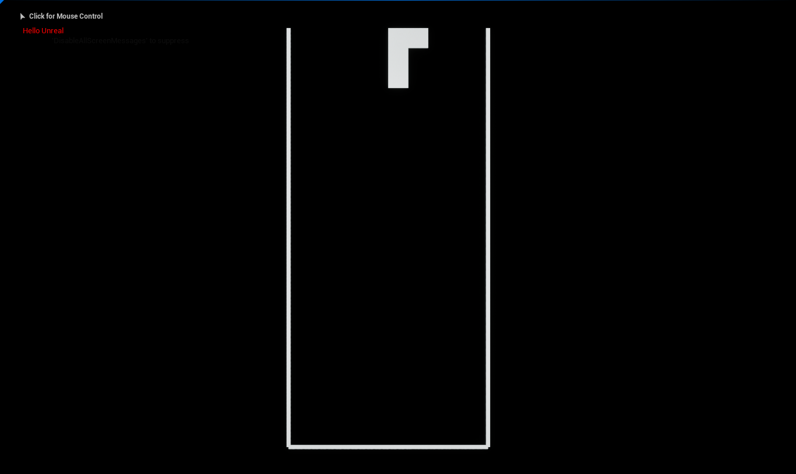
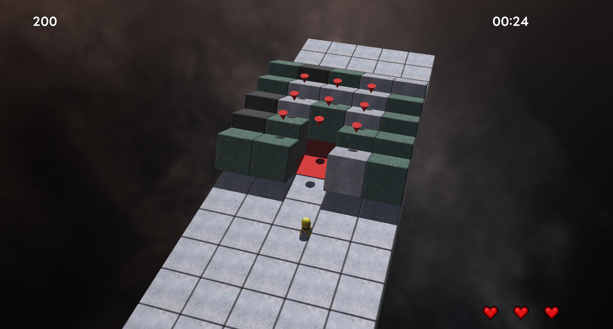
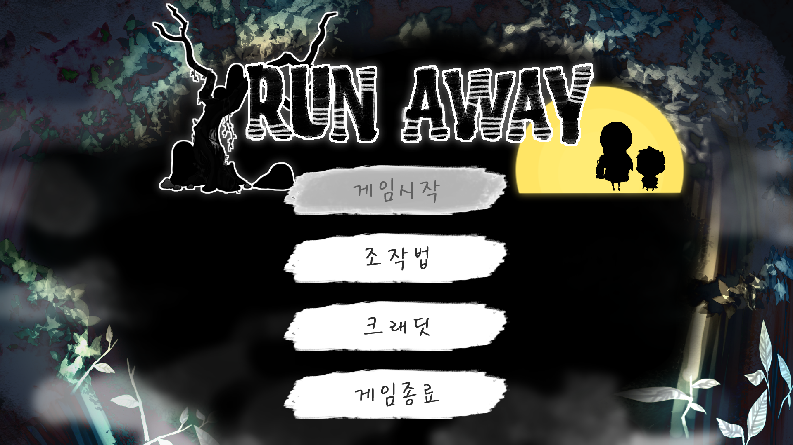

# 게임 · 엔진 개발 포트폴리오

C++ 기반 게임 개발을 중심으로 게임 프레임워크, 렌더링, 수학 라이브러리를 다뤘습니다. 직접 구현한 그래픽스 기능과 팀 프로젝트에서의 구조 설계·최적화 경험을 통해, 문제를 발견하고 해결 방법을 선택한 과정을 정리합니다.

## 전체 프로젝트

최신 프로젝트부터 정리했습니다. 프로젝트 이름을 누르면 구현 내용, 담당 범위, 문제 해결 과정과 코드·영상 링크를 볼 수 있습니다.

| 프로젝트 | 기술 | 기간 · 규모 | 주요 구현·경험 |
| --- | --- | --- | --- |
| [Unreal Tetris](projects/unreal-tetris.md) | C++, Unreal Engine | 1주 · 개인 | 다섯 클래스로 게임 모드·보드·카메라·테트로미노·입력 역할 분리 |
| [Vulkan 초기화 학습](projects/vulkan-study.md) | Vulkan | 1주 · 개인 | 향후 RHI 설계를 위한 초기화 과정 학습과 구조도 정리 |
| [Cube Runner](projects/cube-runner.md) | C++, DirectX 11 | 3개월 · 프로그래머 2명 | 게임 프레임워크·콘텐츠 담당, 빌드 구성에 따른 수학 연산 선택 |
| [Giant Heart](projects/giant-heart.md) | Unity | 3주 · 8명 | 내적을 이용한 벽 투명도 처리, 베지어 곡선 기반 자원 이동 구현 |
| [Dice or Die](projects/dice-or-die.md) | C++, DirectX2D | 3주 · 팀 인원 확인 필요 | 최적화·구조 설계·일정 관리, 개발자별 프로젝트 분리와 빌드 의존성 구성 |
| [Run Away](projects/run-away.md) | C, WinAPI | 2주 · 8명 | 최적화·구조 설계·일정 관리, 알파 블렌딩 병목과 순회 중 상태 변경 문제 해결 |
| [템플릿 메타프로그래밍 학습](projects/template-metaprogramming.md) | C++ 템플릿 | 개인 학습 | *Template Metaprogramming with C++* 원서를 번역하며 학습 |
| [콘솔 3D 렌더러](projects/console-3d.md) | C++, 컴퓨터 그래픽스 | 1주 · 개인 | 벡터·행렬, OBJ 로더, 원근 투영, 클리핑, 래스터라이저 직접 구현 |

## 대표 프로젝트 미리보기

이미지를 누르면 해당 프로젝트의 상세 문서로 이동합니다.

| Unreal Tetris | Cube Runner |
| --- | --- |
| [](projects/unreal-tetris.md) | [](projects/cube-runner.md) |
| Unreal Engine의 게임플레이 구조 학습 | 게임 프레임워크·콘텐츠 구현과 수학 연산 설계 |

| Run Away | 콘솔 3D 렌더러 |
| --- | --- |
| [](projects/run-away.md) | [](projects/console-3d.md) |
| 성능 병목 개선과 객체 상태 변경 처리 | 좌표 변환부터 화면 출력까지 그래픽스 과정 구현 |

## 문서 관리

```text
portfolio/
├── README.md                         # 자기소개, 전체 프로젝트 요약과 링크
├── projects/                         # 프로젝트별 상세 설명
│   ├── unreal-tetris.md
│   ├── vulkan-study.md
│   ├── cube-runner.md
│   ├── giant-heart.md
│   ├── dice-or-die.md
│   ├── run-away.md
│   ├── template-metaprogramming.md
│   └── console-3d.md
└── images/                           # 스크린샷과 구조도
```

- 자기소개와 전체 프로젝트 목록은 이 `README.md`에서 수정합니다.
- 담당 업무, 설계 선택, 문제 해결 과정과 결과물 링크는 `projects/`의 해당 문서에서 관리합니다.
- 스크린샷과 구조도는 `images/`에 보관합니다. 상세 문서에서는 `../images/파일명.png`로 연결합니다.
- 프로젝트를 추가할 때는 상세 문서를 만들고 위 목록에 링크와 요약을 추가합니다.
- 프로젝트 코드는 각각의 기존 코드 저장소에서 관리합니다.

### 보완할 기록

- [ ] [Giant Heart](projects/giant-heart.md)의 공개 가능한 코드 저장소 링크 추가
- [ ] [Run Away](projects/run-away.md) 등 성능 비교의 하드웨어·빌드 구성·장면·측정 방법 정리 또는 재측정

[GitHub · PinkBourbon](https://github.com/PinkBourbon) · [기존 Notion 포트폴리오](https://piros.notion.site/8a26001cbd004222b5f4b263bd98c6f4)

Notion 포트폴리오 이관·정리일: **2026-10-22**
