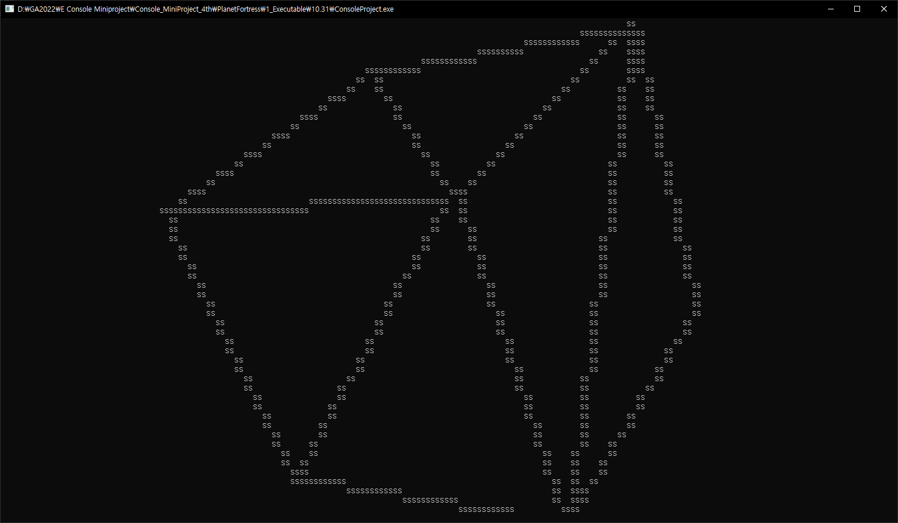
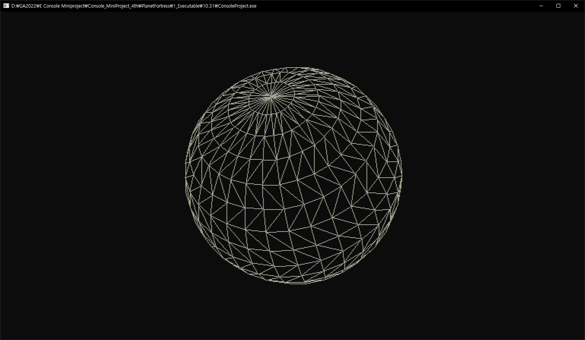

[← 전체 포트폴리오](../README.md)

# 콘솔 3D 렌더러

| 항목 | 내용 |
| --- | --- |
| 기술 | C++, 컴퓨터 그래픽스 |
| 기간 · 팀 | 1주 · 개인 개발 |
| 목적 | 게임인재원 첫 프로젝트로 수학과 그래픽스의 기초 학습 |
| 코드 | [GA4thConsoleMini](https://github.com/PinkBourbon/GA4thConsoleMini) |
| 영상 | [YouTube · 실행 영상](https://www.youtube.com/watch?v=ac-kePUpGPM) |
| 원본 기록 | [Notion · 3D](https://piros.notion.site/3D-61b040e0e29342babf6483139ab93715) |

벡터·행렬 연산과 OBJ 로더를 만들고, 행렬을 이용한 계층 구조, 원근 투영, 인덱스를 이용한 삼각형 구성, 뒷면 제거, 근평면 클리핑과 삼각형 분할, 래스터라이저, 더블 버퍼링을 구현했습니다.

## 설계 변경과 시행착오

처음에는 3D 슈팅 게임을 구상했지만, 제한된 기간에 맞춰 **음영 없이 실루엣을 보고 물체를 맞히는 게임**으로 변경했습니다.

테일러 급수로 사인·코사인 함수를 직접 구현하는 실험에서는 정점이 발산하는 문제가 발생해 `<cmath>`의 함수를 사용하도록 바꿨습니다. 수치 연산을 검증하는 테스트가 부족해 원인 파악에 시간이 걸렸고, 음영 처리까지 진행하지 못했습니다.

직접 구현한 그래픽스 과정과 함께, 수학 함수의 정확도를 먼저 검증하는 절차가 왜 필요한지 돌아본 프로젝트입니다.

[← 전체 포트폴리오](../README.md)
