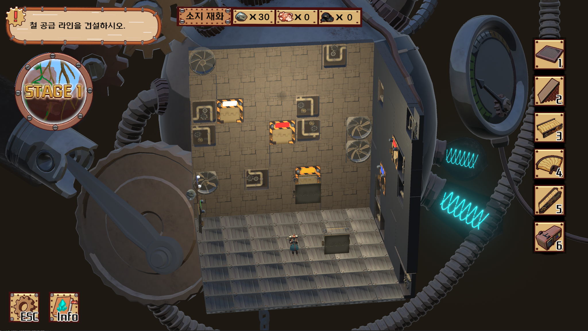

[← 전체 포트폴리오](../README.md)

# Giant Heart

| 항목 | 내용 |
| --- | --- |
| 기술 | Unity |
| 기간 · 팀 | 3주 · 8명: 프로그래머 4명, 아트 2명, 기획 2명 |
| 직접 구현 | 벽 투명도 처리, 자원 컨베이어 이동 경로 |
| 영상 | [YouTube · 실행 영상](https://www.youtube.com/watch?v=P4HUMyXHnjY) |
| 원본 기록 | [Notion · Giant Heart](https://piros.notion.site/Giant-Heart-e495bad232544263959681e606f2cb98) |

## 구현: 카메라 방향에 따른 벽 투명도

카메라의 시선 방향과 벽·중심 사이 벡터의 **내적**을 이용해 벽의 투명도를 처리했습니다. 카메라 방향과 벽의 위치 관계를 계산에 반영한 기능입니다.

## 구현과 한계: 곡선 위의 자원 이동

자원 컨베이어의 이동 경로에는 베지어 곡선을 사용했습니다. 다만 매개변수 `t`를 일정하게 증가시켜도 곡선 위에서 이동하는 거리는 일정하지 않아, 자원의 이동 속도가 구간마다 달라졌습니다. **이 속도 불균일 문제는 당시 해결하지 못한 과제**로 남았습니다.

원본 기록에 코드 저장소 링크가 없어, 현재는 실행 영상과 구현 설명을 제공합니다.

[← 전체 포트폴리오](../README.md)
