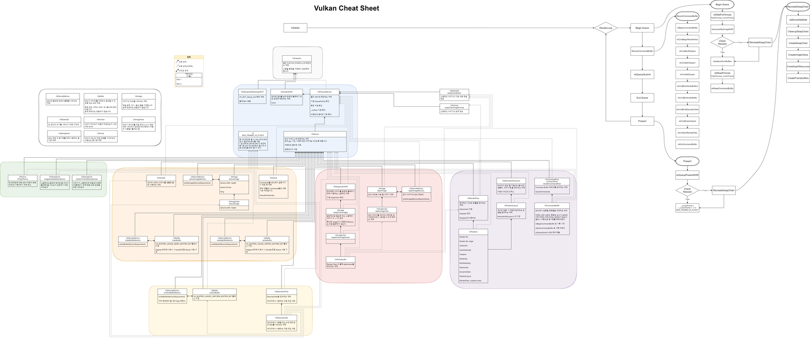

[← 전체 포트폴리오](../README.md)

# Vulkan 초기화 학습

| 항목 | 내용 |
| --- | --- |
| 기술 | Vulkan |
| 기간 · 팀 | 1주 · 개인 학습 |
| 범위 | `vulkan_tutorial_en`을 따라 초기화 과정 학습 |
| 코드 | [FloaterRendererVulkan](https://github.com/FinalPoopHead/CurtainCall3D/tree/yh/Floater/FloaterRendererVulkan) |
| 원본 기록 | [Notion · Vulkan](https://piros.notion.site/Vulkan-20b432cf43c28039a3cedb29202f9d4f) |

향후 엔진의 렌더링 하드웨어 추상화 계층(RHI)을 설계하기 위한 사전 조사로 Vulkan을 학습했습니다. 튜토리얼을 따라 초기화 과정을 진행하고, 필요한 단계와 관계를 그림으로 정리했습니다.

원본 기록에 정리된 구현 범위는 **초기화 학습**입니다. 도식의 원본 파일은 [Notion 기록](https://piros.notion.site/Vulkan-20b432cf43c28039a3cedb29202f9d4f)에서 확인할 수 있습니다.

[← 전체 포트폴리오](../README.md)
